# LAPORAN PRAKTIKUM 7

## PEMROGRAMAN SERVER-SIDE DENGAN PHP

### Identitas Mahasiswa

| | |
|---|---|
| **Nama** | *Rafa Muhammad Fauzan* |
| **NIM** | *312510277* |
| **Kelas** | *I251C* |
| **Program Studi** | *Teknik Informatika* |
| **Mata Kuliah** | Pemrograman Web |
| **Tugas** | Praktikum 7 — Pemrograman Server-Side dengan PHP |
| **Link Repository** | *https://github.com/RafaMuhammadFauzan13/Lab7Web.git* |

---

## Pengertian Praktikum

Praktikum 7 membahas pemrograman server-side dengan PHP. Berbeda dengan HTML, CSS, dan JavaScript yang dijalankan browser (client-side), kode PHP dijalankan oleh web server. Browser hanya menerima hasil keluarannya berupa HTML. Pada praktikum ini dibuat tujuh latihan, satu mini project (formulir data mahasiswa), dan lima eksperimen mandiri yang mencakup sintaks PHP, variabel, function, pemrosesan form dengan metode GET dan POST, serta validasi dan sanitasi input.

## Tujuan Praktikum

1. Memahami perbedaan pemrosesan client-side dan server-side.
2. Mengenali sintaks PHP dan menjalankan file PHP melalui server lokal.
3. Menggunakan variabel, tipe data, operator, percabangan, perulangan, dan function.
4. Menerima dan memproses data dari form HTML menggunakan metode GET dan POST.
5. Melakukan validasi dan sanitasi input dasar sebelum data ditampilkan atau diproses.
6. Membangun aplikasi sederhana yang menerima, memproses, dan menampilkan data pengguna.

## Perangkat

Laptop/PC, web browser, Visual Studio Code, PHP, dan server lokal XAMPP.

## Cara Menjalankan Server Lokal

1. Buka XAMPP Control Panel lalu klik **Start** pada modul **Apache**.
2. Salin folder `Lab7Web_PHP` ke direktori `htdocs` (contoh: `C:\xampp\htdocs\Lab7Web_PHP`).
3. Buka browser dan akses `http://localhost/Lab7Web_PHP/`.
4. Pilih latihan yang ingin dibuka dari halaman menu `index.php`.

File PHP tidak boleh dibuka dengan klik ganda (`file://`) karena tidak diproses oleh PHP. Browser hanya menampilkan kode mentahnya.

## Struktur File

```text
Lab7Web_PHP/
├── index.php            (menu daftar latihan)
├── latihan1.php         (menjalankan PHP)
├── latihan2.php         (variabel, operator, percabangan)
├── latihan3.php         (perulangan dan array)
├── latihan4.php         (function)
├── latihan5.php         (form GET)
├── latihan6.php         (form POST)
├── latihan7.php         (pengolahan data sederhana)
├── mini_project.php     (formulir data mahasiswa)
├── README.md
├── eksperimen/
│   ├── eksperimen1.php  (nilai rata-rata)
│   ├── eksperimen2.php  (pencarian nama, GET)
│   ├── eksperimen3.php  (format Rupiah)
│   ├── eksperimen4.php  (validasi NIM)
│   └── eksperimen5.php  (reset vs proses ulang)
└── images/              (screenshot untuk README)
```

---

## Langkah-Langkah Pengerjaan

### 1. Latihan 1 — Menjalankan PHP

**Tujuan:** Memastikan server lokal berjalan dan PHP dieksekusi oleh server.

**Pembahasan:** Kode PHP ditulis di dalam tag `<?php ... ?>` pada dokumen HTML. `echo` mencetak teks ke halaman dan `date()` mengambil waktu dari server. Saat dibuka lewat `localhost`, browser hanya menerima HTML hasilnya, bukan kode PHP.

**CODING (`latihan1.php`):**

```php
<!DOCTYPE html>
<html lang="id">
<head>
 <meta charset="UTF-8">
 <title>Praktikum PHP</title>
</head>
<body>
 <h1>Belajar PHP</h1>
 <?php
 echo "<p>PHP berhasil dijalankan.</p>";
 echo "<p>Waktu server: " . date("d-m-Y H:i:s") . "</p>";
 ?>
</body>
</html>
```

**Hasil Browser:**

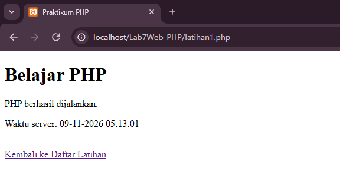

**Keterangan:**

Teks "PHP berhasil dijalankan." dan waktu server muncul di halaman, sedangkan tag `<?php` tidak terlihat. Ini menunjukkan PHP diproses di server lebih dulu sebelum dikirim ke browser. Waktu akan berubah setiap halaman dimuat ulang.

---

### 2. Latihan 2 — Variabel, Operator, dan Percabangan

**Tujuan:** Menggunakan variabel, operator aritmatika, dan percabangan `if`, `elseif`, `else`.

**Pembahasan:** Variabel PHP diawali tanda `$`. Nilai akhir dihitung dengan bobot tugas 30%, UTS 30%, dan UAS 40%. Predikat ditentukan oleh percabangan berdasarkan nilai akhir.

**CODING (`latihan2.php`):**

```php
<!DOCTYPE html>
<html lang="id">
<head>
 <meta charset="UTF-8">
 <title>Latihan 2 - Variabel, Operator, Percabangan</title>
</head>
<body>
<?php
$nama = "Siti";
$tugas = 85;
$uts = 78;
$uas = 90;

$nilaiAkhir = ($tugas * 0.30) + ($uts * 0.30) + ($uas * 0.40);

if ($nilaiAkhir >= 85) {
 $predikat = "A";
} elseif ($nilaiAkhir >= 75) {
 $predikat = "B";
} elseif ($nilaiAkhir >= 60) {
 $predikat = "C";
} else {
 $predikat = "D";
}

echo "Nama: " . htmlspecialchars($nama) . "<br>";
echo "Nilai akhir: " . number_format($nilaiAkhir, 2) . "<br>";
echo "Predikat: " . $predikat;
?>
</body>
</html>
```

**Hasil Browser:**

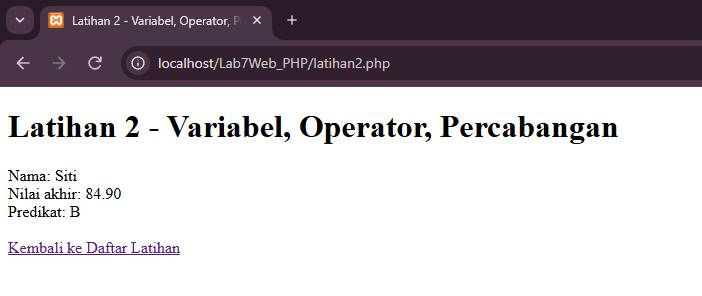

**Keterangan:**

Perhitungannya adalah (85 × 0,30) + (78 × 0,30) + (90 × 0,40) = 84,90, sehingga predikatnya **B** karena nilai belum mencapai 85. `number_format($nilaiAkhir, 2)` menampilkan dua angka desimal. Nilai tugas, UTS, dan UAS diubah-ubah untuk menguji kombinasi lain, misalnya nilai 90, 90, 90 menghasilkan predikat A.

---

### 3. Latihan 3 — Perulangan dan Array

**Tujuan:** Menyimpan banyak data dalam array dan menampilkannya dengan `foreach`.

**Pembahasan:** Array `$mahasiswa` berisi daftar nama. `foreach` mengambil setiap elemen satu per satu dan mencetaknya sebagai item daftar bernomor. Sesuai instruksi, ditambahkan tiga nama baru (Eka, Fajar, Gita).

**CODING (`latihan3.php`):**

```php
<!DOCTYPE html>
<html lang="id">
<head>
 <meta charset="UTF-8">
 <title>Latihan 3 - Perulangan dan Array</title>
</head>
<body>
<?php
// Tiga nama baru (Eka, Fajar, Gita) ditambahkan sesuai instruksi modul
$mahasiswa = ["Alya", "Bima", "Citra", "Doni", "Eka", "Fajar", "Gita"];

echo "<h3>Daftar Mahasiswa</h3><ol>";
foreach ($mahasiswa as $nama) {
 echo "<li>" . htmlspecialchars($nama) . "</li>";
}
echo "</ol>";
?>
</body>
</html>
```

**Hasil Browser:**

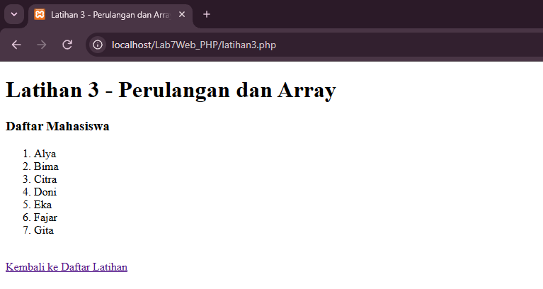

**Keterangan:**

Tujuh nama tampil dalam daftar bernomor. `htmlspecialchars()` dipakai pada setiap nama agar karakter khusus tidak dibaca sebagai HTML.

---

### 4. Latihan 4 — Membuat Function

**Tujuan:** Membuat function agar perhitungan yang sama dapat dipakai berulang.

**Pembahasan:** `hitungDiskon()` menerima harga dan persen diskon lalu mengembalikan harga akhir dengan `return`. Sebagai tambahan, dibuat `hitungLuasPersegiPanjang()` dan `tentukanKelulusan()`.

**CODING (`latihan4.php`):**

```php
<!DOCTYPE html>
<html lang="id">
<head>
 <meta charset="UTF-8">
 <title>Latihan 4 - Function</title>
</head>
<body>
<?php
function hitungDiskon($harga, $persen) {
 $potongan = $harga * ($persen / 100);
 return $harga - $potongan;
}

// Function tambahan sesuai instruksi modul
function hitungLuasPersegiPanjang($panjang, $lebar) {
 return $panjang * $lebar;
}

function tentukanKelulusan($nilai) {
 return $nilai >= 60 ? "Lulus" : "Tidak Lulus";
}

$hargaAkhir = hitungDiskon(150000, 10);
echo "Harga setelah diskon: Rp" . number_format($hargaAkhir, 0, ",", ".") . "<br>";
echo "Luas persegi panjang (8 x 4): " . hitungLuasPersegiPanjang(8, 4) . "<br>";
echo "Kelulusan (nilai 78): " . tentukanKelulusan(78);
?>
</body>
</html>
```

**Hasil Browser:**

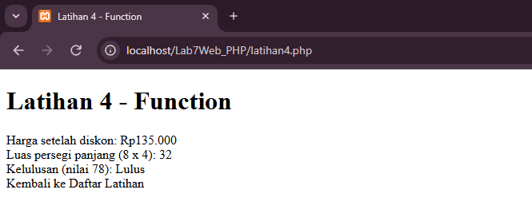

**Keterangan:**

Harga Rp150.000 dengan diskon 10% menjadi Rp135.000. Luas persegi panjang 8 × 4 adalah 32, dan nilai 78 menghasilkan "Lulus" karena batas kelulusan yang dipakai adalah 60. `number_format($hargaAkhir, 0, ",", ".")` memformat angka dengan titik sebagai pemisah ribuan.

---

### 5. Latihan 5 — Memproses Form dengan GET

**Tujuan:** Menerima data form melalui parameter URL dengan metode GET.

**Pembahasan:** Form dikirim dengan `method="GET"` sehingga data muncul di URL. PHP membaca data lewat `$_GET`. Fungsi `isset()` memastikan form sudah dikirim, `trim()` membuang spasi di awal dan akhir, dan `htmlspecialchars()` mengamankan tampilan.

**CODING (`latihan5.php`):**

```php
<!DOCTYPE html>
<html lang="id">
<head>
 <meta charset="UTF-8">
 <title>Latihan 5 - Form GET</title>
</head>
<body>
<!-- cari.php -->
<form method="GET" action="">
 <label for="kata">Kata kunci:</label>
 <input id="kata" name="kata" type="text">
 <button type="submit">Cari</button>
</form>
<?php
if (isset($_GET["kata"])) {
 $kata = trim($_GET["kata"]);
 echo "Kata kunci: " . htmlspecialchars($kata, ENT_QUOTES, "UTF-8");
}
?>
</body>
</html>
```

**Hasil Browser:**

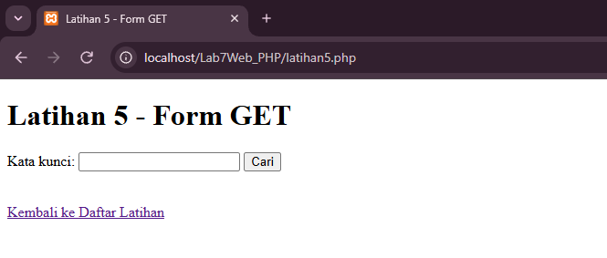

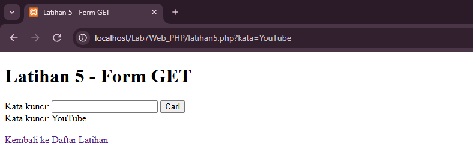

**Keterangan:**

Setelah tombol Cari ditekan, URL berubah menjadi `latihan5.php?kata=...`. GET cocok untuk pencarian, tetapi tidak boleh dipakai untuk kata sandi atau data sensitif karena datanya terlihat di URL dan riwayat browser.

---

### 6. Latihan 6 — Memproses Form dengan POST

**Tujuan:** Menerima data form dengan metode POST dan memvalidasi input kosong.

**Pembahasan:** Data dikirim di body permintaan sehingga tidak tampil di URL. PHP membaca data lewat `$_POST`. Operator `??` memberi nilai cadangan kosong jika kolom tidak ada, dan `$_SERVER["REQUEST_METHOD"] === "POST"` memastikan pemrosesan hanya terjadi setelah form dikirim.

**CODING (`latihan6.php`):**

```php
<!DOCTYPE html>
<html lang="id">
<head>
 <meta charset="UTF-8">
 <title>Latihan 6 - Form POST</title>
</head>
<body>
<form method="POST" action="">
 <label for="nama">Nama:</label>
 <input id="nama" name="nama" type="text" required>
 <label for="prodi">Program Studi:</label>
 <input id="prodi" name="prodi" type="text" required>
 <button type="submit" name="kirim">Kirim Data</button>
</form>
<?php
if ($_SERVER["REQUEST_METHOD"] === "POST") {
 $nama = trim($_POST["nama"] ?? "");
 $prodi = trim($_POST["prodi"] ?? "");

 if ($nama === "" || $prodi === "") {
 echo "<p>Semua kolom wajib diisi.</p>";
 } else {
 echo "<h3>Data diterima</h3>";
 echo "Nama: " . htmlspecialchars($nama, ENT_QUOTES, "UTF-8") . "<br>";
 echo "Program Studi: " . htmlspecialchars($prodi, ENT_QUOTES, "UTF-8");
 }
}
?>
</body>
</html>
```

**Hasil Browser:**

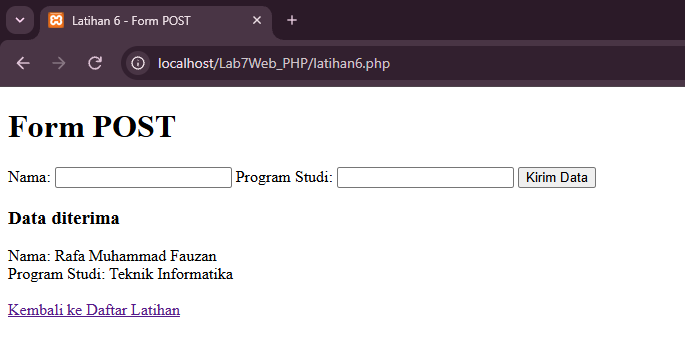

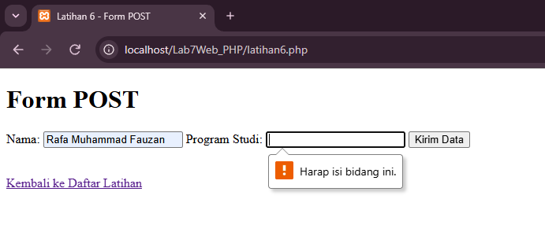

**Keterangan:**

Jika salah satu kolom kosong, muncul pesan "Semua kolom wajib diisi." Saat dicoba memasukkan `<b>tebal</b>` atau tanda kutip, teks tampil apa adanya karena `htmlspecialchars()` mengubahnya menjadi entitas HTML sehingga tidak dijalankan sebagai tag.

---

### 7. Latihan 7 — Pengolahan Data Sederhana

**Tujuan:** Menghitung subtotal belanja dari nama barang, harga, dan jumlah dengan validasi server-side.

**Pembahasan:** Harga diperiksa dengan `is_numeric()`, jumlah diperiksa dengan `ctype_digit()` dan harus minimal 1. Jika salah satu syarat gagal, pesan error ditampilkan. Jika valid, nilai dikonversi ke `float` dan `int` lalu dikalikan menjadi subtotal. Function `rupiah()` memformat hasil ke dalam Rupiah.

**CODING (`latihan7.php`):**

```php
<!DOCTYPE html>
<html lang="id">
<head>
    <meta charset="UTF-8">
    <title>Latihan 7 - Pengolahan Data Sederhana</title>
</head>
<body>
    <h1>Latihan 7 - Pengolahan Data Sederhana</h1>

    <?php
    $error = null;
    $subtotal = null;

    // Mengubah angka menjadi format Rupiah
    function rupiah($angka) {
        return "Rp" . number_format($angka, 2, ",", ".");
    }

    // Proses data hanya jika form dikirim dengan metode POST
    if ($_SERVER["REQUEST_METHOD"] === "POST") {
        $barang = trim($_POST["barang"] ?? "");
        $hargaInput = $_POST["harga"] ?? "";
        $jumlahInput = $_POST["jumlah"] ?? "";

        // Validasi di sisi server
        if ($barang === "" || !is_numeric($hargaInput) ||
            !ctype_digit((string)$jumlahInput) ||
            (float)$hargaInput < 0 || (int)$jumlahInput < 1) {
            $error = "Periksa kembali nama barang, harga, dan jumlah.";
        } else {
            $harga = (float)$hargaInput;
            $jumlah = (int)$jumlahInput;
            $subtotal = $harga * $jumlah; // subtotal = harga x jumlah
        }
    }
    ?>

    <form method="POST">
        <label>Nama barang <input name="barang" value="<?= htmlspecialchars($_POST["barang"] ?? "", ENT_QUOTES, "UTF-8") ?>" required></label>
        <label>Harga <input name="harga" type="number" min="0" step="0.01" value="<?= htmlspecialchars($_POST["harga"] ?? "", ENT_QUOTES, "UTF-8") ?>" required></label>
        <label>Jumlah <input name="jumlah" type="number" min="1" step="1" value="<?= htmlspecialchars($_POST["jumlah"] ?? "", ENT_QUOTES, "UTF-8") ?>" required></label>
        <button type="submit">Hitung</button>
    </form>

    <?php if ($error !== null): ?>
        <p><strong>Error:</strong> <?= htmlspecialchars($error) ?></p>
    <?php elseif ($subtotal !== null): ?>
        <h3>Hasil Perhitungan</h3>
        <p>Barang: <?= htmlspecialchars($barang) ?></p>
        <p>Harga satuan: <?= rupiah($harga) ?></p>
        <p>Jumlah: <?= $jumlah ?></p>
        <p>Subtotal (harga x jumlah): <strong><?= rupiah($subtotal) ?></strong></p>
    <?php endif; ?>

    <br>
    <a href="index.php">Kembali ke Daftar Latihan</a>
</body>
</html>
```

**Hasil Browser:**

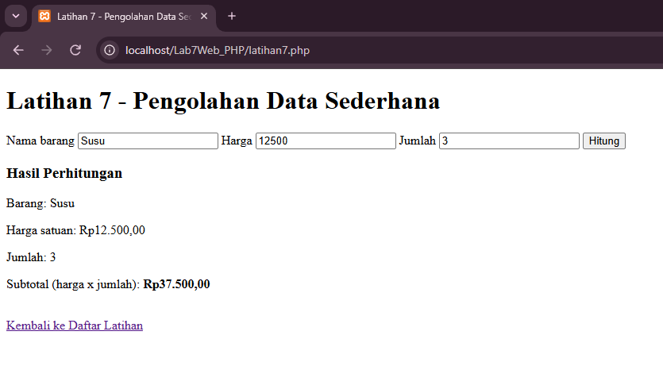

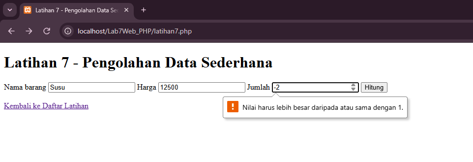

**Keterangan:**

Contoh: Pensil, harga 2500, jumlah 4 menghasilkan subtotal Rp10.000,00. Jumlah 0 atau negatif ditolak dengan pesan "Periksa kembali nama barang, harga, dan jumlah." Atribut `min` dan `required` pada HTML hanya membantu pengguna, sedangkan validasi PHP tetap menjadi pemeriksaan utama.

---

### 8. Mini Project — Formulir Data Mahasiswa

**Tujuan:** Membuat aplikasi sederhana yang menerima data mahasiswa, memvalidasinya di server, lalu menampilkan ringkasannya.

**Pembahasan:** Form memuat nama, NIM, program studi, semester, dan email dengan metode POST. Pesan kesalahan dikumpulkan dalam array `$error` sehingga semuanya tampil sekaligus. Aturan validasi: nama, NIM, dan program studi wajib diisi, NIM berupa 9 digit angka, semester bilangan bulat 1–14, dan email berformat valid (`filter_var` dengan `FILTER_VALIDATE_EMAIL`). Bagian pemrosesan diletakkan di atas file dan dipisahkan dari tampilan HTML di bawahnya. Function `e()` membungkus `htmlspecialchars()` agar penulisan lebih ringkas.

**CODING (`mini_project.php`):**

```php
<?php
$data = null;
$error = [];

if ($_SERVER["REQUEST_METHOD"] === "POST") {
 $nama = trim($_POST["nama"] ?? "");
 $nim = trim($_POST["nim"] ?? "");
 $prodi = trim($_POST["prodi"] ?? "");
 $semesterInput = $_POST["semester"] ?? "";
 $email = trim($_POST["email"] ?? "");

 if ($nama === "") $error[] = "Nama wajib diisi.";
 if ($nim === "") $error[] = "NIM wajib diisi.";
 if ($prodi === "") $error[] = "Program studi wajib diisi.";

 if (!filter_var($email, FILTER_VALIDATE_EMAIL)) {
 $error[] = "Format email tidak valid.";
 }

 if (!ctype_digit((string)$semesterInput) ||
 (int)$semesterInput < 1 || (int)$semesterInput > 14) {
 $error[] = "Semester harus berupa angka 1–14.";
 }

 if (!$error) {
 $data = compact("nama", "nim", "prodi", "email");
 $data["semester"] = (int)$semesterInput;
 }
}

function e($teks) {
 return htmlspecialchars((string)$teks, ENT_QUOTES, "UTF-8");
}
?>
<!DOCTYPE html>
<html lang="id">
<head>
 <meta charset="UTF-8">
 <title>Mini Project - Formulir Data Mahasiswa</title>
</head>
<body>
 <h1>Formulir Data Mahasiswa</h1>

 <form method="POST" action="">
 <p>
 <label for="nama">Nama:</label><br>
 <input id="nama" name="nama" type="text" value="<?= e($_POST["nama"] ?? "") ?>" required>
 </p>
 <p>
 <label for="nim">NIM:</label><br>
 <input id="nim" name="nim" type="text" value="<?= e($_POST["nim"] ?? "") ?>" required>
 </p>
 <p>
 <label for="prodi">Program Studi:</label><br>
 <input id="prodi" name="prodi" type="text" value="<?= e($_POST["prodi"] ?? "") ?>" required>
 </p>
 <p>
 <label for="semester">Semester:</label><br>
 <input id="semester" name="semester" type="number" min="1" max="14" value="<?= e($_POST["semester"] ?? "") ?>" required>
 </p>
 <p>
 <label for="email">Email:</label><br>
 <input id="email" name="email" type="email" value="<?= e($_POST["email"] ?? "") ?>" required>
 </p>
 <button type="submit">Kirim</button>
 <button type="reset">Reset</button>
 </form>

 <?php if ($error): ?>
 <div>
 <strong>Terdapat kesalahan:</strong>
 <ul>
 <?php foreach ($error as $pesan): ?>
 <li><?= e($pesan) ?></li>
 <?php endforeach; ?>
 </ul>
 </div>
 <?php endif; ?>

 <?php if ($data): ?>
 <h3>Data Mahasiswa Diterima</h3>
 <table border="1" cellpadding="6">
 <tr><th>Nama</th><td><?= e($data["nama"]) ?></td></tr>
 <tr><th>NIM</th><td><?= e($data["nim"]) ?></td></tr>
 <tr><th>Program Studi</th><td><?= e($data["prodi"]) ?></td></tr>
 <tr><th>Semester</th><td><?= e($data["semester"]) ?></td></tr>
 <tr><th>Email</th><td><?= e($data["email"]) ?></td></tr>
 </table>
 <?php endif; ?>

 <br>
 <a href="index.php">Kembali ke Daftar Latihan</a>
</body>
</html>
```

**Hasil Browser:**

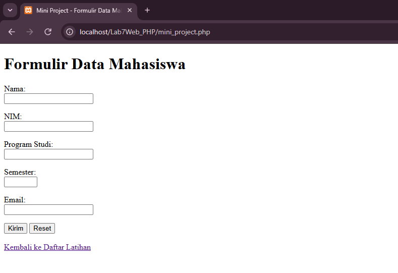

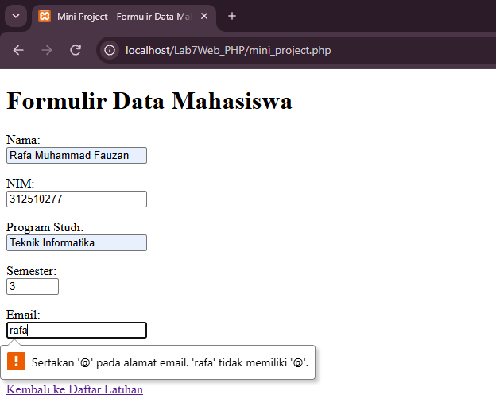

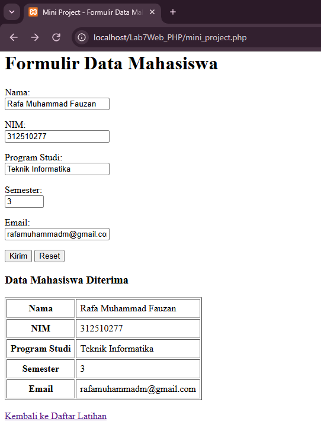

**Keterangan:**

Jika ada error, seluruh pesan ditampilkan dalam daftar dan isian form tidak hilang. Jika semua valid, ringkasan data tampil dalam tabel. Tombol Reset mengembalikan isian form ke nilai awalnya.

---

## Eksperimen Mandiri

### 9. Eksperimen 1 — Nilai Rata-rata

**Tujuan:** Menambahkan perhitungan nilai rata-rata dari tiga komponen nilai.

**Pembahasan:** Function `hitungRataRata()` menjumlahkan tiga nilai lalu membaginya dengan 3. Setiap nilai divalidasi sebagai angka 0–100. Predikat ikut ditampilkan.

**CODING (`eksperimen/eksperimen1.php`):**

```php
<?php
// Eksperimen 1: Perhitungan nilai rata-rata dari tiga komponen nilai
$error = [];
$rataRata = null;

function hitungRataRata($a, $b, $c) {
    return ($a + $b + $c) / 3;
}

if ($_SERVER["REQUEST_METHOD"] === "POST") {
    $nilai = [];
    foreach (["tugas" => "Tugas", "uts" => "UTS", "uas" => "UAS"] as $k => $label) {
        $input = $_POST[$k] ?? "";
        if (!is_numeric($input) || (float)$input < 0 || (float)$input > 100) {
            $error[] = "Nilai $label harus berupa angka 0–100.";
        } else {
            $nilai[$k] = (float)$input;
        }
    }
    if (!$error) {
        $rataRata = hitungRataRata($nilai["tugas"], $nilai["uts"], $nilai["uas"]);
        $predikat = $rataRata >= 85 ? "A" : ($rataRata >= 75 ? "B" : ($rataRata >= 60 ? "C" : "D"));
    }
}
function nilaiLama($k) { return htmlspecialchars($_POST[$k] ?? "", ENT_QUOTES, "UTF-8"); }
?>
<!DOCTYPE html>
<html lang="id">
<head>
    <meta charset="UTF-8">
    <title>Eksperimen 1 - Nilai Rata-rata</title>
</head>
<body>
    <h1>Eksperimen 1 - Nilai Rata-rata</h1>

    <form method="POST">
        <label>Tugas <input name="tugas" type="number" min="0" max="100" step="0.01" value="<?= nilaiLama("tugas") ?>" required></label>
        <label>UTS <input name="uts" type="number" min="0" max="100" step="0.01" value="<?= nilaiLama("uts") ?>" required></label>
        <label>UAS <input name="uas" type="number" min="0" max="100" step="0.01" value="<?= nilaiLama("uas") ?>" required></label>
        <button type="submit">Hitung</button>
    </form>

    <?php if ($error): ?>
        <p><strong>Error:</strong></p>
        <ul><?php foreach ($error as $e): ?><li><?= htmlspecialchars($e) ?></li><?php endforeach; ?></ul>
    <?php elseif ($rataRata !== null): ?>
        <h3>Hasil Perhitungan</h3>
        <p>Tugas: <?= number_format($nilai["tugas"], 2) ?></p>
        <p>UTS: <?= number_format($nilai["uts"], 2) ?></p>
        <p>UAS: <?= number_format($nilai["uas"], 2) ?></p>
        <p>Rata-rata: <strong><?= number_format($rataRata, 2) ?></strong></p>
        <p>Predikat: <strong><?= $predikat ?></strong></p>
    <?php endif; ?>

    <br>
    <a href="../index.php">Kembali ke Daftar Latihan</a>
</body>
</html>
```

**Hasil Browser:**

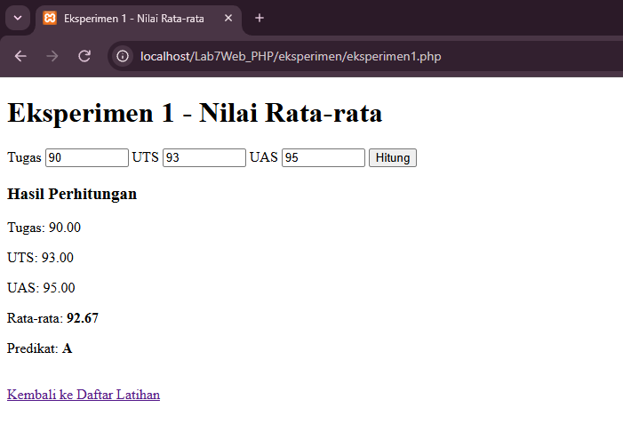

**Keterangan:**

Contoh: Tugas 85, UTS 78, UAS 90 menghasilkan rata-rata (85 + 78 + 90) / 3 = 84,33 dengan predikat B. Nilai di luar 0–100 atau bukan angka ditolak dengan pesan error.

---

### 10. Eksperimen 2 — Pencarian Nama (GET)

**Tujuan:** Mengubah contoh GET agar dapat mencari nama dari array data sederhana.

**Pembahasan:** Array `$dataMahasiswa` berisi sembilan nama. `foreach` memeriksa tiap nama dengan `stripos()` sehingga pencarian tidak membedakan huruf besar dan kecil, dan nama yang mengandung kata kunci dikumpulkan sebagai hasil.

**CODING (`eksperimen/eksperimen2.php`):**

```php
<?php
// Eksperimen 2: Pencarian nama dari array data sederhana dengan metode GET
$dataMahasiswa = [
    "Alya Putri", "Bima Saputra", "Citra Lestari", "Doni Pratama",
    "Eka Wijaya", "Fajar Nugraha", "Gita Ayu", "Hana Citra", "Indra Maulana"
];

$kata = null;
$hasil = [];

if (isset($_GET["kata"])) {
    $kata = trim($_GET["kata"]);
    if ($kata !== "") {
        foreach ($dataMahasiswa as $nama) {
            if (stripos($nama, $kata) !== false) { // tidak membedakan huruf besar/kecil
                $hasil[] = $nama;
            }
        }
    }
}
?>
<!DOCTYPE html>
<html lang="id">
<head>
    <meta charset="UTF-8">
    <title>Eksperimen 2 - Pencarian Nama (GET)</title>
</head>
<body>
    <h1>Eksperimen 2 - Pencarian Nama (GET)</h1>

    <form method="GET" action="">
        <label for="kata">Kata kunci:</label>
        <input id="kata" name="kata" type="text" value="<?= htmlspecialchars($kata ?? "", ENT_QUOTES, "UTF-8") ?>">
        <button type="submit">Cari</button>
    </form>

    <?php if ($kata !== null): ?>
        <?php if ($kata === ""): ?>
            <p><strong>Error:</strong> Kata kunci tidak boleh kosong.</p>
        <?php elseif ($hasil): ?>
            <h3>Ditemukan <?= count($hasil) ?> nama untuk "<?= htmlspecialchars($kata, ENT_QUOTES, "UTF-8") ?>"</h3>
            <ol><?php foreach ($hasil as $n): ?><li><?= htmlspecialchars($n) ?></li><?php endforeach; ?></ol>
        <?php else: ?>
            <p>Tidak ada nama yang cocok dengan "<?= htmlspecialchars($kata, ENT_QUOTES, "UTF-8") ?>".</p>
        <?php endif; ?>
    <?php endif; ?>

    <p><em>Perhatikan URL di address bar setelah menekan Cari: kata kunci muncul sebagai parameter ?kata=...</em></p>

    <a href="../index.php">Kembali ke Daftar Latihan</a>
</body>
</html>
```

**Hasil Browser:**

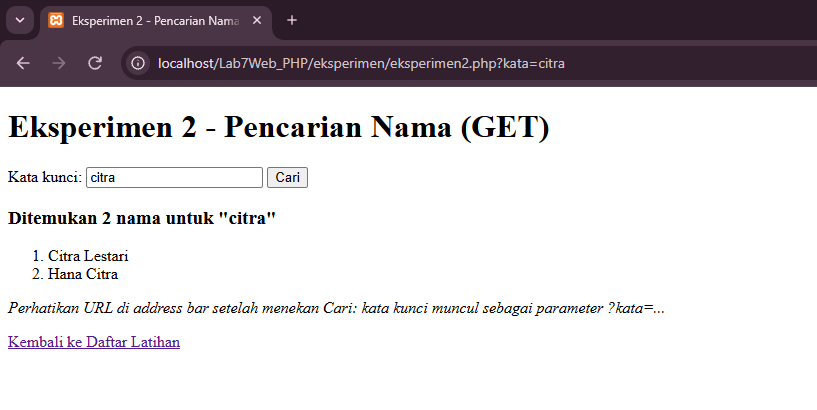

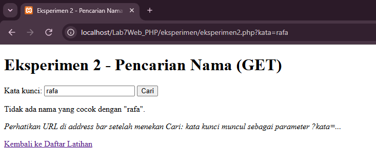

**Keterangan:**

Mencari `citra` menemukan dua nama (Citra Lestari dan Hana Citra). Kata kunci kosong menampilkan error, dan kata yang tidak ada menampilkan pesan tidak ditemukan. Kata kunci terlihat di URL sebagai `?kata=citra`.

---

### 11. Eksperimen 3 — Format Rupiah

**Tujuan:** Membuat function untuk mengubah format harga menjadi Rupiah.

**Pembahasan:** Function `formatRupiah()` membungkus `number_format()` dengan pemisah ribuan titik lalu menambahkan awalan `Rp`. Function dipakai untuk hasil input pengguna dan untuk daftar contoh harga.

**CODING (`eksperimen/eksperimen3.php`):**

```php
<?php
// Eksperimen 3: Function untuk mengubah format harga menjadi Rupiah
function formatRupiah($angka) {
    return "Rp" . number_format($angka, 0, ",", ".");
}

$contoh = [
    "Pensil" => 2500,
    "Buku Tulis" => 12000,
    "Tas Ransel" => 175000,
    "Laptop" => 8750000,
];

$error = null;
$hasil = null;
if ($_SERVER["REQUEST_METHOD"] === "POST") {
    $input = $_POST["harga"] ?? "";
    if (!is_numeric($input) || (float)$input < 0) {
        $error = "Masukkan harga berupa angka dan tidak negatif.";
    } else {
        $hasil = formatRupiah((float)$input);
    }
}
?>
<!DOCTYPE html>
<html lang="id">
<head>
    <meta charset="UTF-8">
    <title>Eksperimen 3 - Format Rupiah</title>
</head>
<body>
    <h1>Eksperimen 3 - Format Rupiah</h1>

    <form method="POST">
        <label>Harga <input name="harga" type="number" min="0" step="0.01" value="<?= htmlspecialchars($_POST["harga"] ?? "", ENT_QUOTES, "UTF-8") ?>" required></label>
        <button type="submit">Ubah ke Rupiah</button>
    </form>

    <?php if ($error): ?>
        <p><strong>Error:</strong> <?= htmlspecialchars($error) ?></p>
    <?php elseif ($hasil !== null): ?>
        <p>Hasil: <strong><?= htmlspecialchars($hasil) ?></strong></p>
    <?php endif; ?>

    <h3>Contoh Daftar Harga</h3>
    <ul>
        <?php foreach ($contoh as $nama => $harga): ?>
            <li><?= htmlspecialchars($nama) ?>: <?= formatRupiah($harga) ?></li>
        <?php endforeach; ?>
    </ul>

    <a href="../index.php">Kembali ke Daftar Latihan</a>
</body>
</html>
```

**Hasil Browser:**

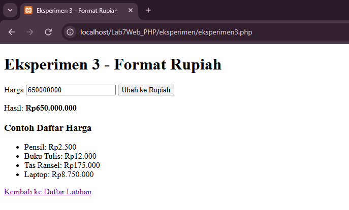

**Keterangan:**

Input 1500000 menghasilkan `Rp1.500.000`. Dengan function, format harga cukup ditulis satu kali lalu dipanggil di banyak tempat.

---

### 12. Eksperimen 4 — Validasi NIM

**Tujuan:** Menambahkan validasi agar NIM hanya berisi angka dan panjangnya sesuai ketentuan.

**Pembahasan:** Ketentuan yang ditetapkan: NIM hanya angka dan tepat 9 digit, disimpan dalam konstanta `PANJANG_NIM`. Pemeriksaan berurutan: kosong, bukan angka (`ctype_digit()`), lalu panjang (`strlen()`). Hasil diberi warna merah untuk error dan hijau untuk valid.

**CODING (`eksperimen/eksperimen4.php`):**

```php
<?php
// Eksperimen 4: Validasi NIM - hanya angka dan panjang tepat 9 digit
const PANJANG_NIM = 9; // ketentuan yang ditetapkan

$error = [];
$data = null;

if ($_SERVER["REQUEST_METHOD"] === "POST") {
    $nama = trim($_POST["nama"] ?? "");
    $nim = trim($_POST["nim"] ?? "");

    if ($nama === "") {
        $error[] = "Nama wajib diisi.";
    }
    if ($nim === "") {
        $error[] = "NIM wajib diisi.";
    } elseif (!ctype_digit($nim)) {
        $error[] = "NIM hanya boleh berisi angka.";
    } elseif (strlen($nim) !== PANJANG_NIM) {
        $error[] = "NIM harus tepat " . PANJANG_NIM . " digit (Anda memasukkan " . strlen($nim) . " digit).";
    }

    if (!$error) {
        $data = ["nama" => $nama, "nim" => $nim];
    }
}
function e($t) { return htmlspecialchars((string)$t, ENT_QUOTES, "UTF-8"); }
?>
<!DOCTYPE html>
<html lang="id">
<head>
    <meta charset="UTF-8">
    <title>Eksperimen 4 - Validasi NIM</title>
    <style>
        .error { color: #b91c1c; background: #fee2e2; border: 1px solid #ef4444; padding: 8px 12px; }
        .valid { color: #166534; background: #dcfce7; border: 1px solid #22c55e; padding: 8px 12px; }
        .error ul, .valid p { margin: 4px 0; }
    </style>
</head>
<body>
    <h1>Eksperimen 4 - Validasi NIM</h1>
    <p>Aturan: NIM hanya berisi angka dan tepat <?= PANJANG_NIM ?> digit.</p>

    <form method="POST">
        <label>Nama <input name="nama" value="<?= e($_POST["nama"] ?? "") ?>"></label>
        <label>NIM <input name="nim" value="<?= e($_POST["nim"] ?? "") ?>"></label>
        <button type="submit">Kirim</button>
    </form>

    <?php if ($error): ?>
        <div class="error">
            <strong>Error:</strong>
            <ul><?php foreach ($error as $m): ?><li><?= e($m) ?></li><?php endforeach; ?></ul>
        </div>
    <?php elseif ($data): ?>
        <div class="valid">
            <strong>NIM valid</strong>
            <p>Nama: <?= e($data["nama"]) ?></p>
            <p>NIM: <?= e($data["nim"]) ?></p>
        </div>
    <?php endif; ?>
    <br>

    <a href="../index.php">Kembali ke Daftar Latihan</a>
</body>
</html>
```

**Hasil Browser:**

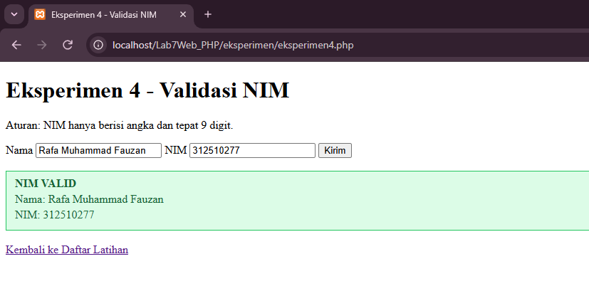

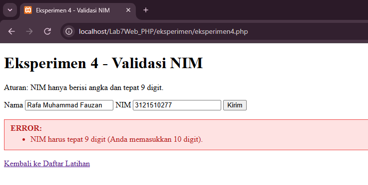

**Keterangan:**

`312510277` valid. `12345` ditolak karena kurang digit, dan `31251027A` ditolak karena mengandung huruf.

---

### 13. Eksperimen 5 — Reset vs Proses Ulang

**Tujuan:** Menambahkan tombol reset pada form dan menjelaskan perbedaannya dengan pemrosesan ulang di server.

**Pembahasan:** Form memiliki tombol Kirim, Reset (`type="reset"`), dan tautan Kosongkan. Halaman menampilkan waktu server untuk membuktikan kapan skrip PHP dijalankan ulang.

**CODING (`eksperimen/eksperimen5.php`):**

```php
<?php
// Eksperimen 5: Tombol reset vs pemrosesan ulang di server
$diproses = false;
$nama = $email = "";

if ($_SERVER["REQUEST_METHOD"] === "POST") {
    $nama = trim($_POST["nama"] ?? "");
    $email = trim($_POST["email"] ?? "");
    $diproses = true;
}
function e($t) { return htmlspecialchars((string)$t, ENT_QUOTES, "UTF-8"); }
?>
<!DOCTYPE html>
<html lang="id">
<head>
    <meta charset="UTF-8">
    <title>Eksperimen 5 - Reset vs Proses Ulang</title>
</head>
<body>
    <h1>Eksperimen 5 - Reset vs Proses Ulang</h1>

    <form method="POST" action="">
        <label>Nama <input name="nama" value="<?= e($nama) ?>"></label>
        <label>Email <input name="email" type="email" value="<?= e($email) ?>"></label>
        <button type="submit">Kirim</button>
        <button type="reset">Reset</button>
        <a href="eksperimen5.php">Kosongkan</a>
    </form>

    <h3><?= $diproses ? "Data diterima server" : "Belum ada data dikirim" ?></h3>
    <p>Waktu server memproses halaman: <strong><?= date("H:i:s") ?></strong></p>
    <?php if ($diproses): ?>
        <p>Nama: <?= e($nama) ?></p>
        <p>Email: <?= e($email) ?></p>
    <?php endif; ?>

    <h3>Perbedaannya</h3>
    <p><strong>Reset</strong> hanya bekerja di browser (client-side): isian dikembalikan ke nilai awal atribut value, tanpa mengirim permintaan ke server. Waktu server tidak berubah. Setelah data dikirim, nilai awal form adalah data yang dikirim tadi, sehingga Reset mengembalikan isian ke data tersebut, bukan mengosongkannya.</p>
    <p><strong>Kirim / Kosongkan</strong> membuat permintaan baru ke server, PHP menjalankan ulang seluruh skrip, dan halaman dibuat ulang. Waktu server berubah. Kosongkan memuat ulang halaman tanpa data POST, sehingga form benar-benar kosong.</p>

    <a href="../index.php">Kembali ke Daftar Latihan</a>
</body>
</html>
```

**Hasil Browser:**

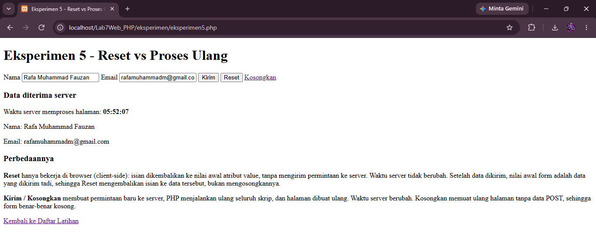

**Keterangan:**

**Reset** hanya bekerja di browser: isian dikembalikan ke nilai awal atribut `value` tanpa permintaan ke server, sehingga waktu server tidak berubah. Setelah data dikirim, nilai awal form adalah data tersebut, jadi Reset mengembalikan isian ke data itu, bukan mengosongkannya. **Kirim atau Kosongkan** membuat permintaan baru ke server dan PHP menjalankan ulang seluruh skrip, sehingga waktu server berubah.

---

### 14. Kasus Uji Input Valid dan Tidak Valid

Pengujian dilakukan pada Latihan 7, Mini Project, dan Eksperimen 4. Untuk menguji validasi PHP, atribut `required`, `min`, `max`, dan tipe `email` pada HTML dinonaktifkan sementara (misalnya dengan menambahkan atribut `novalidate` pada tag `<form>`) agar browser tidak menolak input lebih dulu.

| No | Halaman | Input | Jenis | Hasil |
|---|---|---|---|---|
| 1 | Latihan 7 | Susu, harga 12500, jumlah 3 | Valid | Subtotal Rp37.500,00 |
| 2 | Latihan 7 | Susu, harga 12500, jumlah 0 | Tidak valid | Muncul pesan "Periksa kembali nama barang, harga, dan jumlah." |
| 3| Latihan 7 | Nama barang berisi spasi saja | Tidak valid | Muncul pesan error yang sama karena nama kosong setelah `trim()` |
| 4 | Mini Project | Rafa Muhammad Fauzan, 312510277, Teknik Informatika, semester 3, email `rafamuhammadm@gmail.com` | Valid | Ringkasan data mahasiswa tampil |
| 5 | Mini Project | Rafa Muhammad Fauzan, 312510277, Teknik Informatika, semester 3, email `rafa` | Tidak valid | Format email tidak valid |
| 6 | Eksperimen 4 | NIM `312510277` | Valid | Kotak hijau "NIM valid" |
| 7 | Eksperimen 4 | NIM `3121510277` | Tidak valid | Kotak merah: NIM harus tepat 9 digit (memasukkan 10 digit) |

---

## Pertanyaan Evaluasi

**1. Apa perbedaan pemrosesan client-side dan server-side?**

Pemrosesan client-side dijalankan di browser pengguna, contohnya HTML, CSS, dan JavaScript. Pemrosesan server-side dijalankan di server, contohnya PHP, yaitu menerima permintaan, memproses input, menjalankan aturan aplikasi, dan mengirim respons kembali ke browser. Browser hanya menerima hasil akhirnya (misalnya HTML), bukan kode PHP-nya.

**2. Mengapa file PHP harus dijalankan melalui web server?**

Browser tidak bisa menjalankan PHP. Kode PHP harus diproses oleh interpreter PHP yang terpasang di web server (Apache pada XAMPP). Jika file dibuka dengan klik ganda (`file://`), tidak ada server yang memprosesnya sehingga browser hanya menampilkan kode mentahnya. Karena itu file diakses lewat alamat seperti `http://localhost/Lab7Web_PHP/`.

**3. Apa fungsi tanda `$` pada variabel PHP?**

Tanda `$` menandai bahwa sebuah nama adalah variabel, misalnya `$nama` dan `$umur`. Tanpa tanda `$`, PHP menganggapnya bukan variabel. Nama variabel bersifat case-sensitive, sehingga `$nama` dan `$Nama` dianggap berbeda.

**4. Apa perbedaan metode GET dan POST?**

GET mengirim data lewat parameter URL, sehingga terlihat di address bar, tersimpan di riwayat browser, dan cocok untuk permintaan yang tidak mengubah data seperti pencarian. POST mengirim data di body permintaan sehingga tidak tampil di URL dan lazim dipakai untuk pengiriman form. POST bukan enkripsi, jadi data sensitif tetap harus dikirim lewat HTTPS.

**5. Mengapa input pengguna perlu divalidasi di sisi server?**

Validasi di browser (atribut `required`, `min`, tipe `email`, atau JavaScript) hanya membantu pengguna dan bisa dilewati, misalnya dengan mengubah HTML lewat Inspect Element atau mengirim permintaan langsung. Validasi server-side memastikan data yang diproses tetap benar, utuh, dan aman dari input yang salah atau berbahaya, apa pun cara data itu dikirim.

**6. Apa fungsi `htmlspecialchars()` ketika menampilkan data dari form?**

Fungsi ini mengubah karakter khusus HTML seperti `<`, `>`, `&`, dan tanda kutip menjadi entitas HTML (misalnya `&lt;` dan `&gt;`). Dengan begitu input seperti `<script>` tampil sebagai teks biasa dan tidak dijalankan browser. Ini mengurangi risiko injeksi HTML/script (XSS).

**7. Apa manfaat penggunaan function dalam program PHP?**

Function membuat kode dapat dipakai berulang tanpa menulis ulang, sehingga program lebih singkat. Kode menjadi lebih terstruktur dan mudah dibaca karena setiap function punya satu tugas. Perbaikan atau perubahan cukup dilakukan di satu tempat. Function juga memudahkan pengujian, seperti `hitungDiskon()` dan `formatRupiah()` pada praktikum ini.

---

## Kesimpulan

Berdasarkan Praktikum 7, dapat disimpulkan bahwa PHP merupakan bahasa server-side yang dijalankan di web server, sehingga file PHP harus diakses melalui `localhost`. Variabel, percabangan, perulangan, array, dan function dapat digunakan untuk memproses data, sedangkan form HTML dengan metode GET dan POST digunakan untuk mengirim data dari pengguna ke server.

Validasi server-side (`trim()`, `is_numeric()`, `ctype_digit()`, `filter_var()`) dan sanitasi keluaran dengan `htmlspecialchars()` diperlukan agar data yang diproses benar dan tampilannya aman. Validasi HTML hanya membantu pengguna, sedangkan validasi PHP tetap menjadi pemeriksaan utama.

## Dokumentasi

Screenshot hasil browser diletakkan setelah penjelasan masing-masing langkah di folder `images/`. Pastikan nama file gambar sama dengan yang tertulis di README ini, semua gambar sudah ada di repository, dan repository berstatus **Public** sebelum link dikumpulkan.
